# Studia-IA

Prototipo v0 de la web/app para estudiantes de la ECF (organización, estudio, racha y progresión).
Construido a partir del documento de ideas del grupo.

> **Estado: prototipo navegable.** Todos los datos se guardan en el navegador
> (`localStorage`). La capa de persistencia ya está preparada para connectarse a
> Supabase (ver *Datos y persistencia*).

---

## 1. Cómo abrir la app

Cualquiera de estas tres opciones funciona:

| Opción | Pasos |
|---|---|
| **Doble clic** | Abre `index.html` en el navegador. Funciona sin servidor. |
| **XAMPP / Apache** | Copia la carpeta a `htdocs` (ya está en `htdocs_hecpiqbel/proyecto_grupo_prog`) y entra en `http://localhost/htdocs_hecpiqbel/proyecto_grupo_prog/`. |
| **Servidor propio** | `python3 -m http.server 8000` dentro de la carpeta y abre `http://localhost:8000`. |

No hay `npm install`, ni build, ni dependencias: es HTML + CSS + JavaScript plano.
Eso es deliberado para que cada miembro del equipo pueda trabajar su módulo
sin romper a los demás.

### Comprobar que todo sigue bien

```bash
node tools/check.js      # ~2 s, sin instalar nada
```

Revisa sintaxis de todo el JS, que los assets referenciados existan, que la
versión de caché coincida, que no falten iconos, que cada vista del menú tenga
su ruta, el manifest de la PWA y que nadie use `innerHTML` (regla anti-XSS).

Para el núcleo (migraciones, copia de seguridad, racha, nivel, pomodoro, IA)
abre **`tests.html`** en el navegador: son 20 comprobaciones que copian tus
datos y los restauran al terminar. El mismo `check` se ejecuta en cada push
gracias a `.github/workflows/ci.yml`.

### Capturas del prototipo

En `docs/capturas/` tienes una imagen de cada vista:

| | | | | |
|---|---|---|---|---|
| 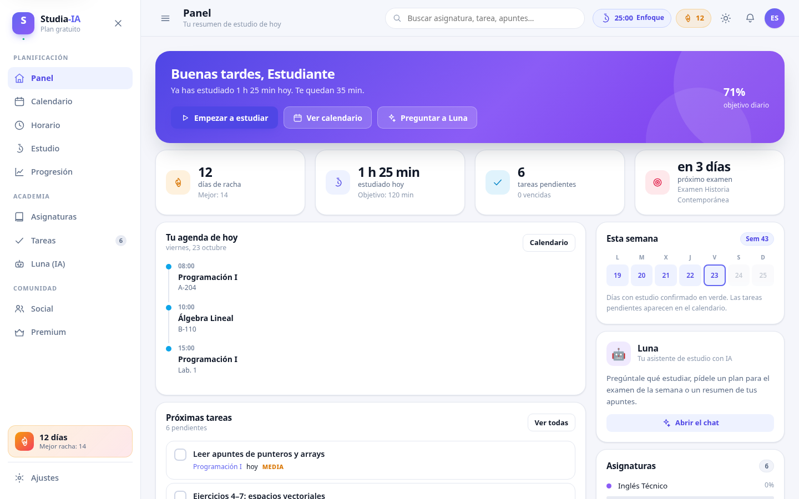 | 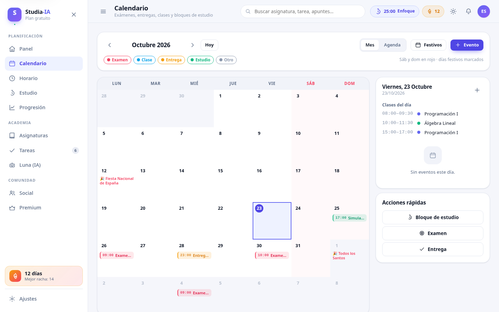 | 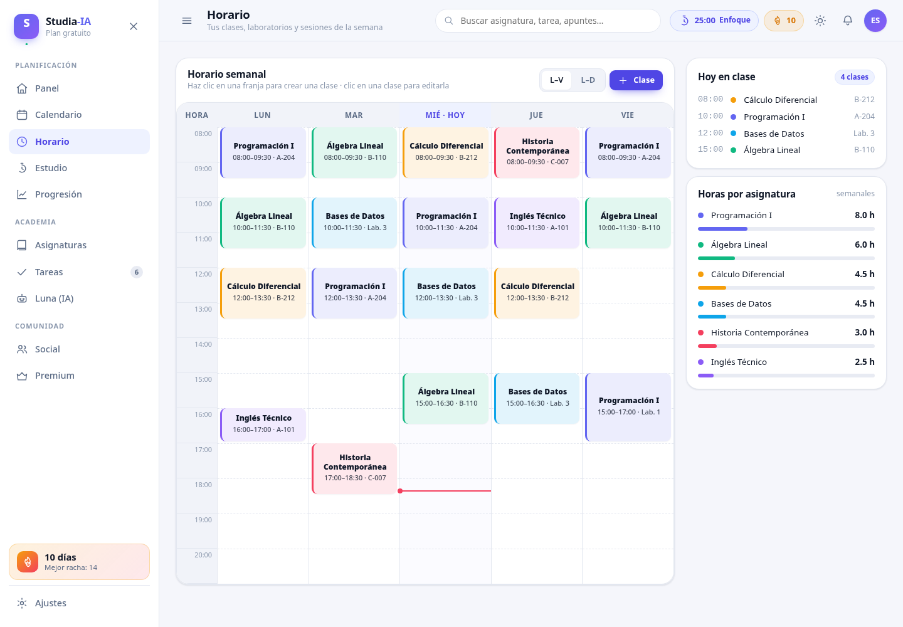 | 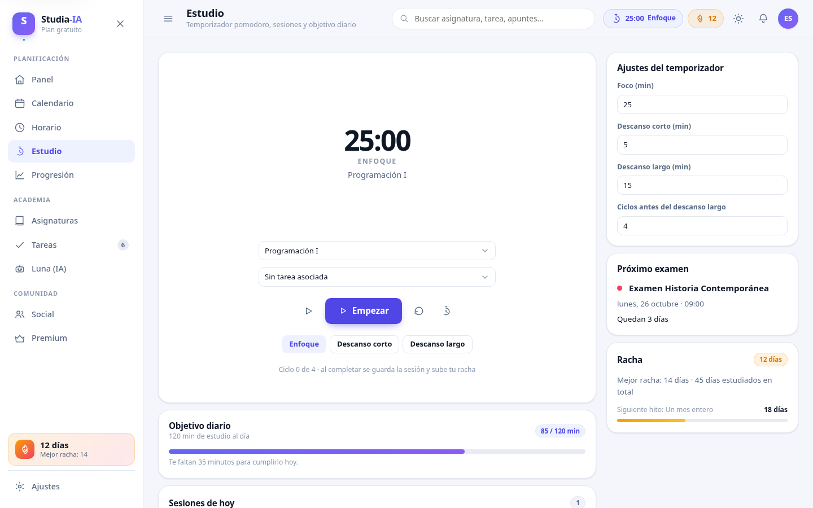 | 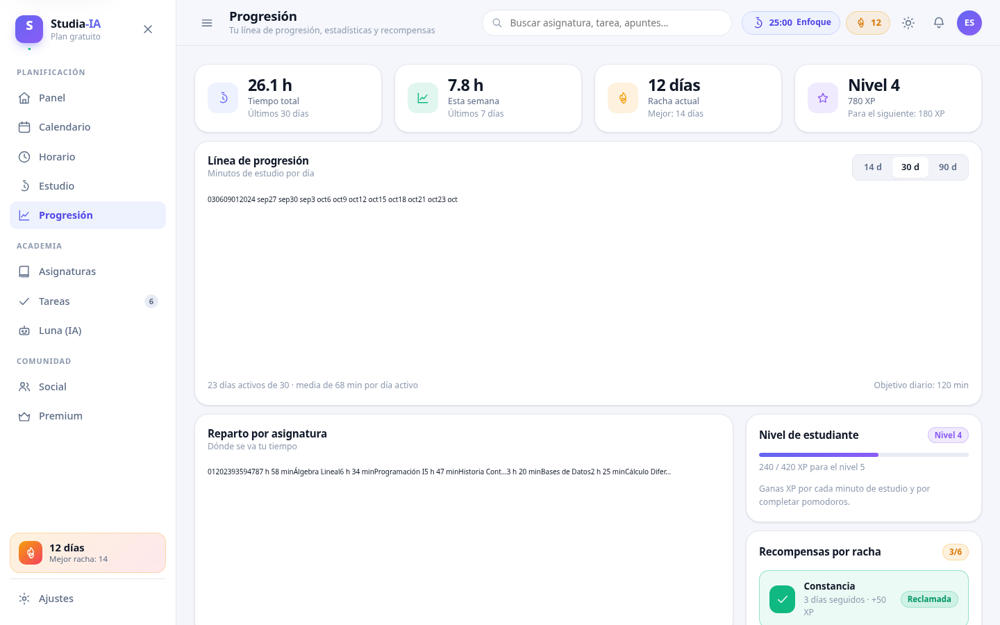 |
| Panel | Calendario | Horario | Estudio | Progresión |
| 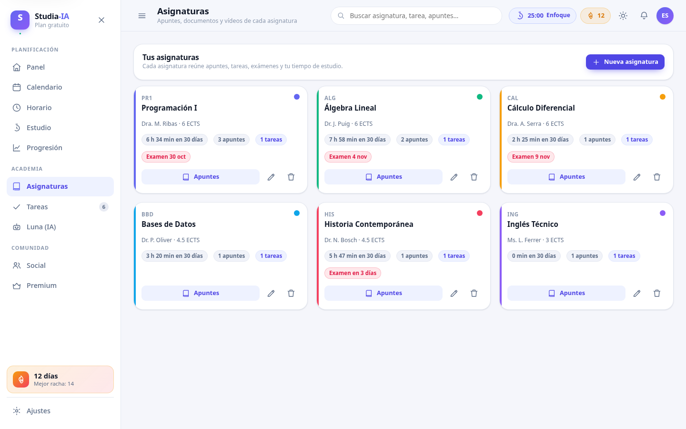 | 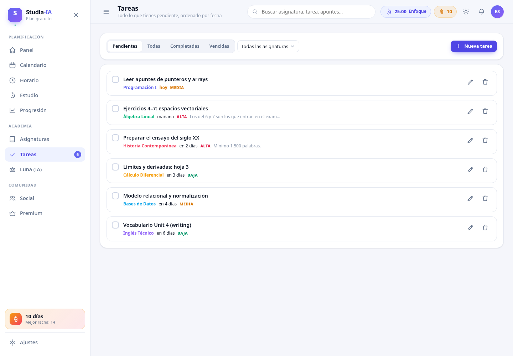 | 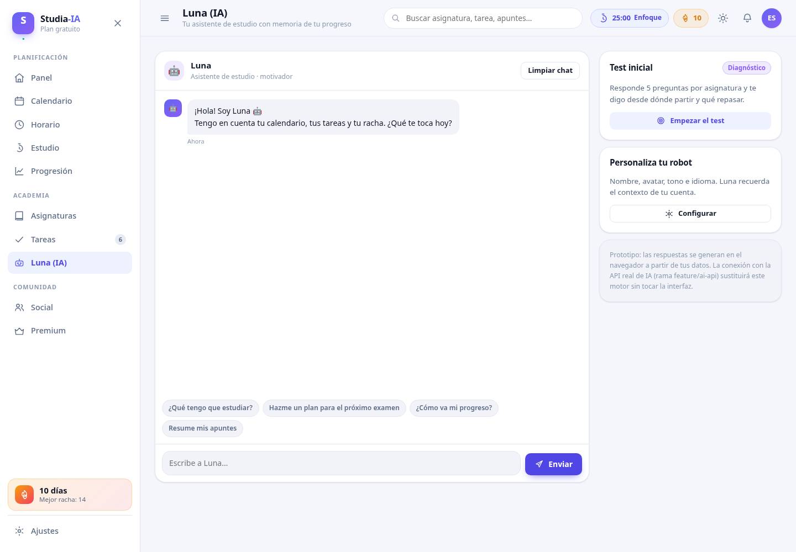 | 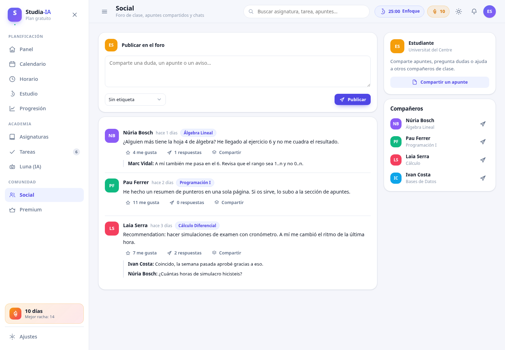 | 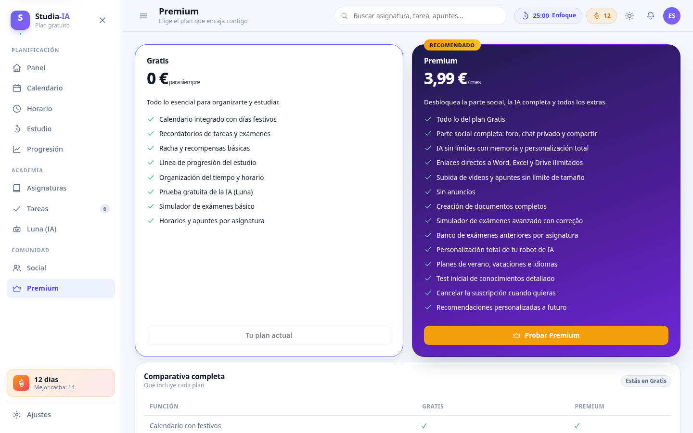 |
| Asignaturas | Tareas | Luna | Social | Premium |

Y cómo se ve en un móvil (390 px de ancho):

| | | |
|---|---|---|
| 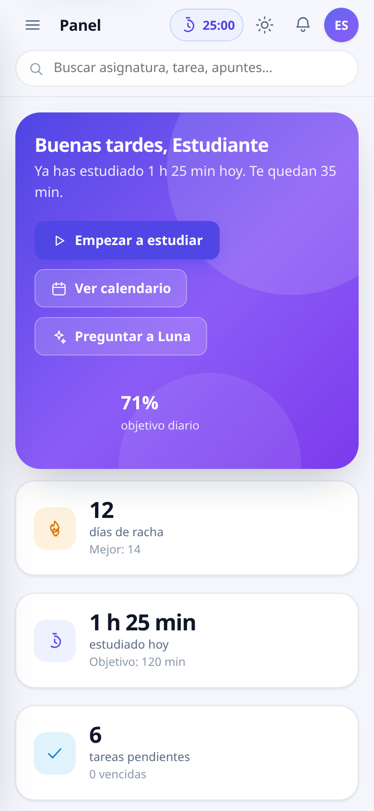 | 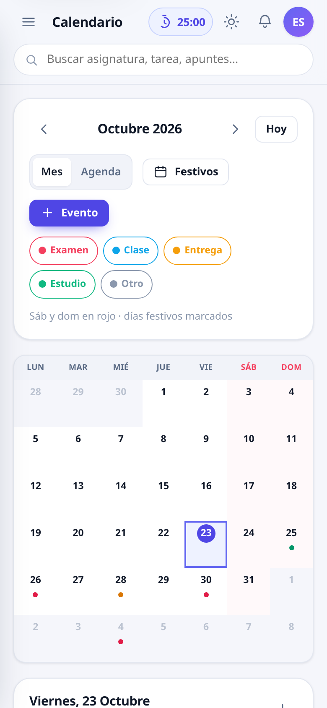 | 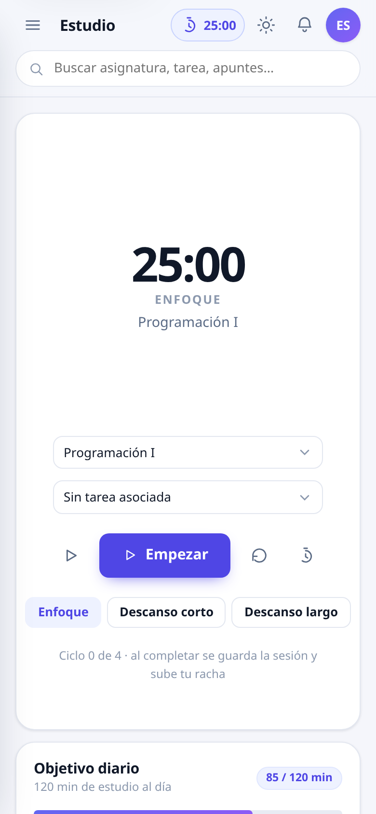 |
| Panel | Calendario | Estudio |


### Atajos de teclado

| Atajo | Acción |
|---|---|
| `/` | Ir al buscador global |
| `t` | Vista Estudio (pomodoro) |
| `c` | Vista Calendario |
| `h` | Vista Horario |

### Si algo falla

La app captura los errores en vez de dejar la pantalla en blanco y los guarda
para poder reportarlos:

1. Menú → perfil → **Ajustes** → botón izquierdo **Diagnóstico**.
2. Pulsa **Copiar** y pega el texto en el grupo. Incluye versión, navegador,
   tamaño de pantalla, datos cargados y los últimos errores.

Si un error ocurre mientras usas la app, aparece un aviso rojo "Algo ha
fallado": al pulsarlo copia ese mismo diagnóstico. Si una vista concreta se
rompe, verás una tarjeta con "Copiar error" y "Volver al panel" en lugar de
una página vacía.

### Versión y caché

`index.html` carga los CSS y JS con `?v=0.2.0` para que el navegador no se
quede con una versión vieja. **Si cambias un archivo y no ves los cambios,
sube ese número** en `index.html` y en `<meta name="app-version">`; después
ejecuta `node tools/check.js`, que avisa si `APP_VERSION` (en `main.js`) y
`package.json` se han quedado atrás.

---

## 2. Qué hay dentro

| Módulo | Ruta | Qué hace |
|---|---|---|
| **Panel** | `#/dashboard` | Resumen del día, agenda, tareas, progreso y accesos rápidos. |
| **Calendario** | `#/calendar` | Vista mensual + agenda. Eventos (examen, clase, entrega, bloque de estudio), días festivos por comunidad, CRUD completo. |
| **Horario** | `#/schedule` | Rejilla semanal L–V (o L–D), clases y laboratorios, detección de solapamientos, reparto de horas por asignatura. |
| **Estudio** | `#/study` | Pomodoro configurable (foco/descansos/ciclos), registro de sesiones, objetivo diario, avisos de fin de sesión. |
| **Progresión** | `#/progress` | Línea de progresión (gráfico de minutos/día), reparto por asignatura, mapa de calor de 16 semanas, hitos y recompensas por racha, nivel y XP. |
| **Asignaturas** | `#/subjects` | Asignaturas, apuntes, enlaces directos a Word/Excel, subida de documentos y vídeos. |
| **Tareas** | `#/tasks` | Listado por estado/asignatura, prioridad, fecha de entrega, vencimientos. |
| **Luna (IA)** | `#/ai` | Chat con memoria de tu contexto, motor de respuestas local, test inicial de conocimientos, personalización del robot. |
| **Social** | `#/social` | Foro de clase: publicar, compartir apuntes, me gusta y respuestas. |
| **Premium** | `#/premium` | Comparativa Gratis/Premium y activación en modo demo. |

### Racha y recompensas

Un día cuenta como estudiado si se registra al menos 1 minuto. La racha actual
empieza a contar desde ayer si todavía no has estudiado hoy. Los hitos
(3, 7, 14, 30, 60 y 100 días) están definidos en `assets/js/data/rewards.js` y
se desbloquean automáticamente al completar sesiones.

---

## 3. Estructura del proyecto

```
proyecto_grupo_prog/
├── AGENTS.md                  # instrucciones para los agentes de IA (roles y reglas)
├── index.html                 # esqueleto de la app + sprite de iconos SVG
├── tests.html                 # tests del núcleo en el navegador
├── tools/check.js             # comprobaciones estáticas (CI, sin dependencias)
├── package.json               # solo scripts (`npm run check`), sin dependencias
├── manifest.webmanifest       # PWA: nombre, colores e iconos
├── .github/workflows/ci.yml   # ejecuta tools/check.js en cada push
├── assets/
│   ├── css/
│   │   ├── base.css           # variables, reset, tipografía, utilidades
│   │   ├── layout.css         # sidebar, topbar, rejillas, responsive
│   │   ├── components.css     # tarjetas, botones, formularios, modales…
│   │   └── views.css          # estilos de cada módulo (calendario, horario…)
│   ├── js/
│   │   ├── core/
│   │   │   ├── utils.js       # DOM (h), fechas, formato  ← base de todo
│   │   │   ├── ui.js          # modales, toasts, formularios
│   │   │   ├── db.js          # persistencia (local ↔ supabase)
│   │   │   ├── store.js       # estado central + selectores
│   │   │   └── router.js      # enrutado por hash
│   │   ├── data/
│   │   │   ├── holidays.js    # festivos y cálculo de la pascua
│   │   │   ├── rewards.js     # hitos por racha
│   │   │   └── seed.js        # datos de demostración
│   │   ├── modules/           # un archivo por módulo (¡aquí se reparte el trabajo!)
│   │   │   ├── dashboard.js   calendar.js  schedule.js  study.js  progress.js
│   │   │   ├── subjects.js    tasks.js     ai.js        social.js  premium.js
│   │   ├── tests.js           # suite del núcleo (la carga tests.html)
│   │   └── main.js            # arranque: tema, buscador, recordatorios, atajos
│   └── img/                   # favicon.svg + iconos PWA (192, 512, apple-touch)
└── README.md
```

**Regla de oro:** cada módulo es un archivo autónomo dentro de `assets/js/modules/`
y se registra en el router con una línea:

```js
Studia.router.register('mi-modulo', {
  title: 'Mi módulo',
  subtitle: 'Descripción corta',
  render: function (root) { /* pintar aquí */ }
});
```

Si dos personas tocan el mismo archivo, se producirán conflictos. **Por eso
cada quien trabaja en su rama.**

---

## 4. Datos y persistencia

Ahora mismo todo vive en `localStorage` bajo la clave `studia.db.v1`:

```js
{
  version:   2,                // esquema actual (migraciones automáticas)
  profile:   { name, university, plan: 'free'|'premium', ... },
  settings:  { theme, dailyGoal, pomodoro:{work,short,long,cycle}, holidayRegions[] },
  subjects:  [ { id, code, name, color, teacher, credits } ],
  tasks:     [ { id, subjectId, title, due, priority, done } ],
  events:    [ { id, type:'exam'|'class'|'deadline'|'study'|'other', date, start, end } ],
  timetable: [ { id, day:0..4, start:'08:00', end:'09:30', subjectId, room } ],
  sessions:  [ { id, date, minutes, subjectId, mode:'pomodoro'|'free' } ],
  notes:     [ { id, subjectId, type:'link'|'file'|'video', title, url } ],
  forum:     [ { id, author, text, likes, replies[] } ],
  streak:    { history: { '2026-10-21': 95 }, best },
  xp:        780,
  timer:     { mode, total, remaining, running, endAt, cycle, ... } // pomodoro
}
```

### Copias de seguridad, varias pestañas y migraciones

- **Exportar / importar:** Ajustes → **Copia de seguridad** → *Descargar*
  genera un `.json` con todo; *Restaurar* lo vuelve a cargar (pide confirmación
  y valida el archivo). Útil para pasar los datos a otro navegador u ordenador.
- **Varias pestañas:** si abres la app dos veces, los cambios de una aparecen
  en la otra (evento `storage`) sin pisarse.
- **Migraciones:** al guardar se escribe `version`. Si un día cambia la forma
  de los datos, se sube `SCHEMA_VERSION` en `store.js` y se añade el paso
  correspondiente en `migrate()`; las copias antiguas se actualizan solas.
- **Al cerrar:** se fuerza el guardado pendiente (`pagehide`), así que arrancar
  el pomodoro y recargar en el acto no pierde el estado. El pomodoro se
  recupera al volver, incluso si terminó mientras la app estaba cerrada.

### Cómo conectar Supabase en el futuro

`assets/js/core/db.js` ya define la interfaz que usan los módulos:
`load()`, `save()`, `select()`, `insert()`, `update()`, `remove()`.
Para migrar a Supabase basta con rellenar el `supabaseAdapter` (ya está escrito
como esqueleto) y llamar a `Studia.db.use('supabase')` + `Studia.db.configureSupabase(cliente)`.
**Los módulos no necesitan cambiar.**

### Detalle de la IA

El chat de Luna usa un motor de respuestas **local** (`assets/js/modules/ai.js`)
que consulta tus propios datos (tareas, exámenes, racha, apuntes). La interfaz
ya es asíncrona y se puede sustituir sin tocar la vista:

```js
Studia.ai.setEngine({
  name: 'api',
  ask: function (text, ctx, opts) {
    // ctx = perfil, asignaturas, tareas abiertas, próximo examen, minutos…
    // opts.signal = AbortSignal (cancelar si se envía otro mensaje)
    return fetch('/api/luna', { method:'POST', body: JSON.stringify({ text, ctx }), signal: opts.signal })
      .then(function (r) { return r.json(); })   // → { text: '…' }
  }
});
Studia.ai.setEngine(null);   // volver al motor local
```

Si la petición falla se muestra un aviso y el error queda en **Diagnóstico**,
en lugar de dejar el chat colgado.

---

## 5. Plan de ramas

Ramas creadas a partir de este prototipo:

| Rama | Responsable | Archivos |
|---|---|---|---|
| `main` | todos | Base estable (`Web Base`); solo entra por Pull Request |
| `hector` | Héctor | `index.html`, `main.js`, `ai.js`, `dashboard.js` y núcleo (`core/`) |
| `carles` | Carles | `calendar.js`, `schedule.js` |
| `joan` | Joan | `study.js`, `progress.js` |
| `alex` | Alex | `tasks.js`, `subjects.js`, `social.js`, `premium.js` |

El reparto completo y las tareas de cada uno están en
[`docs/roles-y-tareas.md`](docs/roles-y-tareas.md). Las reglas que debe seguir
cada agente de IA están en [`AGENTS.md`](AGENTS.md): al empezar, dile
**"Soy Héctor"** (o tu nombre) y ya sabe qué tocar.

### Flujo de trabajo

```bash
git clone git@github.com:AlexB886/Studia-AI.git
cd Studia-AI
git checkout carles                  # tu rama (hector, carles, joan o alex)
# ... trabajas solo tus módulos ...
node tools/check.js
git add .
git commit -m "feat(calendar): vista semanal y exportar a .ics"
git push origin carles
# y se abre una Pull Request hacia main
```

Reglas para evitar conflictos:
1. **Una persona = una rama.** No toques archivos de otros módulos.
2. Si necesitas tocar `core/` (utils, store, ui), avisa antes en el chat del grupo:
   son los ficheros que todo el mundo usa.
3. Los estilos de un módulo van en `assets/css/views.css`, en su bloque commented.
4. Antes de fusionar: `git pull origin main` y vuelve a probar la app entera.

---

## 6. Ideas del documento que aún no están implementadas

Pendientes para las próximas iteraciones:

- [ ] Subida real de ficheros y vídeos (hoy solo se guarda la referencia).
- [ ] Chats privados en tiempo real y notificaciones push.
- [ ] Compartir contenido de redes sociales (importar notas de Instagram/TikTok).
- [ ] Plan de verano/vacaciones y plan de idiomas (el motor de Luna ya los menciona).
- [ ] Recomendaciones automáticas a futuro.
- [ ] Modo "examen" a pantalla completa con cronómetro y corrección.
- [ ] Buscador de exámenes anteriores por asignatura (banco de preguntas ampliable:
      el que ya hay en `ai.js` es la base).

---

## 7. Limitaciones conocidas del prototipo

- Los datos son **locales al navegador**: si borras los datos del navegador, se pierde todo.
- No hay usuarios ni contraseñas: el perfil es único y local.
- La IA es local (no consume tokens ni llama a ningún servidor).
- Los ficheros "subidos" no se guardan: solo la ficha del apunte.
- En móvil (< 860 px) el horario semanal se desplaza en horizontal: cinco días
  no caben en 360 px sin volverlo ilegible. La columna de horas queda fija.
- La sincronización entre pestañas es del **mismo navegador**: para pasar los
  datos a otro dispositivo hay que usar la copia de seguridad.
- El aviso sonoro del pomodoro puede no oírse si la pestaña está cerrada o el
  móvil suspende el navegador; al volver, el tiempo se recalcula por la hora
  de fin.
- Probado en Chrome de 320 a 1440 px (y en Firefox de escritorio), tanto con
  `file://` como con Apache: sin desbordes horizontales de página ni errores
  de consola.

---

## 8. Documentos del grupo

- [`AGENTS.md`](AGENTS.md) — **instrucciones para los agentes de IA**: rol de cada
  persona, reglas, cómo comprobar y cómo proponer ideas.
- [`docs/roles-y-tareas.md`](docs/roles-y-tareas.md) — **reparto por persona** y
  tareas concretas del momento.
- [`docs/backend.md`](docs/backend.md) — **qué es una base de datos, qué opciones
  hay (Supabase, Firebase, PHP+MySQL) y cuál conviene.** Con el SQL de las
  tablas y el plan de migración paso a paso.
- [`docs/planes.md`](docs/planes.md) — **reparto de funciones entre el plan
  Gratis y el Premium**, con las decisiones que hay que tomar en la reunión
  (precios, prueba gratuita, anuncios,RGPD...).
- `docs/capturas/` — capturas de las 10 vistas.

### Decisiones ya tomadas

| Tema | Decisión |
|---|---|
| Nombre | **Studia-IA** (se mantiene de momento) |
| Backend | De momento **localStorage**; el plan a Supabase está en `docs/backend.md` |
| IA | **Motor local** por ahora; la API real (Luna) se conecta más adelante |
| Premium | La comparativa actual es **provisional**, pendiente de la reunión |
| Stack | HTML + CSS + JS plano, **sin dependencias** para poder trabajar por ramas |
